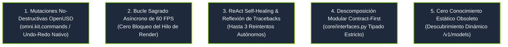
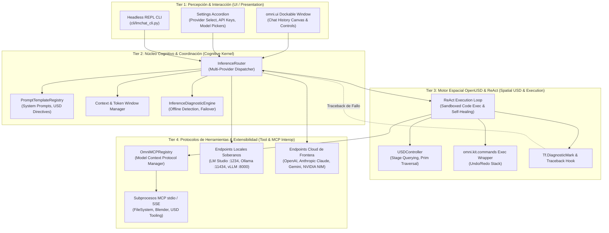
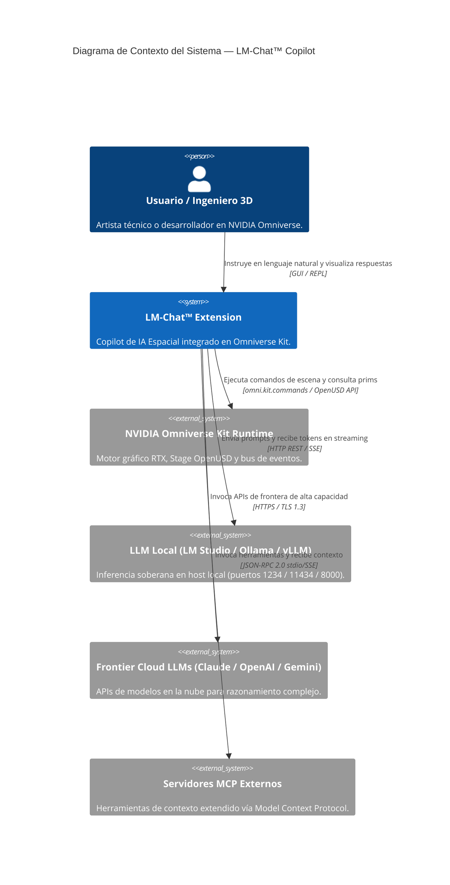
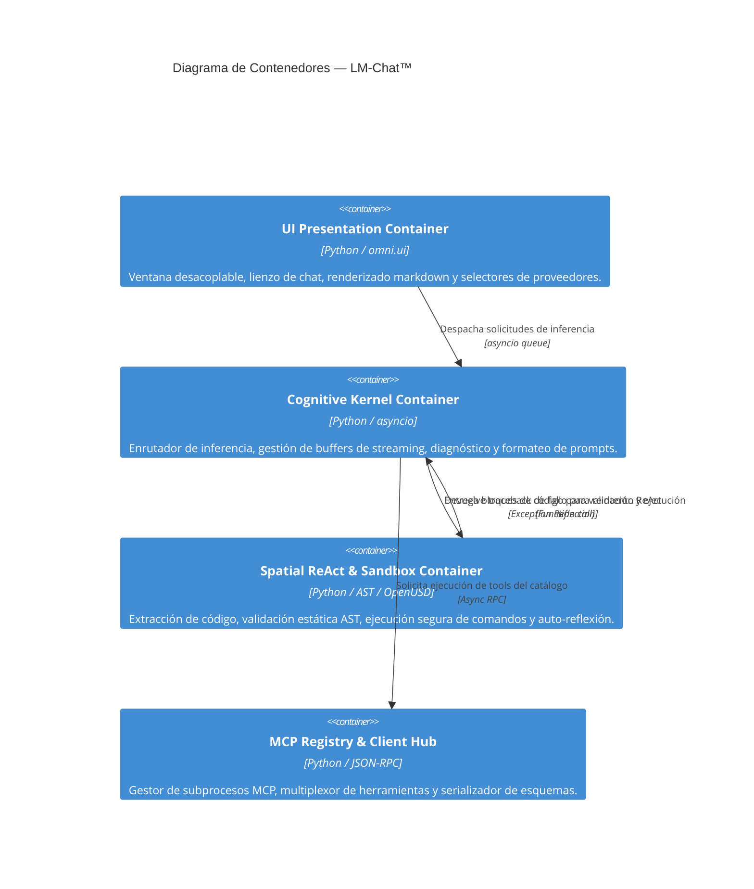

# 🏛️ Documento de Arquitectura de Sistemas de Alto Nivel (HLD)
# LM-Chat™ — Autonomous Spatial AI Copilot for NVIDIA Omniverse

---

## Control de Versiones del Documento

| Versión | Fecha | Autor | Rol | Estado | Resumen de Cambios |
| :--- | :--- | :--- | :--- | :--- | :--- |
| **1.0.0** | 2026-10-14 | Orlando Dorival | Lead Spatial AI Architect | Aprobado | Definición de arquitectura de 4 capas, bucle sagrado de 60 FPS, ReAct self-healing, topología de inferencia híbrida y contratos OpenUSD. |

---

## 1. Resumen Ejecutivo y Visión del Sistema

### 1.1. Propósito y Propuesta de Valor
**LM-Chat™** (`omni.lm_chat`) es un copiloto neuronal y asistente de inteligencia artificial espacial de vanguardia diseñado específicamente para el ecosistema **NVIDIA Omniverse™** (Kit SDK 105, 106, 107+, USD Composer, Isaac Sim y Omniverse Code).

El software resuelve la fricción fundamental existente entre los modelos de lenguaje de gran escala (LLMs) y los motores de simulación espacial 3D:
1. **Traducción Cognitiva Bidireccional:** Convierte intenciones en lenguaje natural humano en operaciones precisas sobre grafos de escena OpenUSD (`pxr.Usd`).
2. **Inferencia Soberana Híbrida:** Proporciona interoperabilidad total con proveedores de inferencia locales (LM Studio, Ollama, vLLM, NVIDIA NIM) y proveedores de frontera en la nube (OpenAI, Anthropic Claude, Google Gemini).
3. **Bucle Autónomo ReAct Autoreparable:** Ejecuta código Python/USD en la escena, inspecciona errores de ejecución mediante `Tf.DiagnosticMark` y reflexiona de forma autónoma para corregir la sintaxis o topología sin intervención del usuario.
4. **Respeto Absoluto al Rendimiento Gráfico:** Garantiza cero congelamientos o caídas de cuadros en el hilo de renderizado principal (60 FPS Sacred Async Loop).

### 1.2. Audiencia y Contexto Operacional
- **Directores Técnicos (TDs) y Artistas 3D:** Automatización de iluminación de escenarios, asignación de materiales MDL/UsdShade, ordenamiento jerárquico y optimización de prims.
- **Ingenieros de Robótica y Simulación (Isaac Sim):** Creación procedimental de entornos de entrenamiento de robots, instanciación de sensores rígidos/deformables y generación de datos sintéticos (SDG).
- **Desarrolladores de Gemelos Digitales:** Enriquecimiento semántico de activos de gemelos digitales mediante metadatos espaciales y orquestación asistida por Model Context Protocol (MCP).

---

## 2. Invariantes Arquitectónicos Fundamentales (Leyes Universales)

Cualquier implementación, extensión o módulo dentro de LM-Chat debe satisfacer de manera obligatoria los siguientes cinco principios invariantes:

### 2.1. Invariante 1: Mutaciones No-Destructivas OpenUSD
Queda terminantemente prohibido alterar el Stage de OpenUSD (`pxr.Usd.Stage`) mediante llamadas destructivas directas que eludan el historial de comandos de Omniverse. Toda creación de prims, traslación, deformación o mutación de atributos se canaliza a través de `omni.kit.commands.execute()` o bloques de comando reversibles con soporte integral de `Ctrl+Z` / `Ctrl+Y`.

### 2.2. Invariante 2: Bucle Sagrado Asíncrono de 60 FPS
El bucle principal de renderizado de NVIDIA Omniverse corre a una cadencia objetivo de 60 FPS (16.6 ms por cuadro) a 120 FPS. Ninguna operación de red, token streaming, inferencia de LLM, serialización de archivos ni computación pesada puede correr de forma síncrona en el hilo principal. Todo trabajo se despacha a través de `asyncio` o ejecutores en segundo plano (`asyncio.run_in_executor`).

### 2.3. Invariante 3: ReAct Self-Healing y Reflexión de Tracebacks
Cuando un script de Python generado por la IA falla durante su ejecución sobre la escena, el sistema intercepta la excepción, captura el diagnóstico exacto (`sys.exc_info()`, `Sdf.PathError`, `Tf.DiagnosticMark`), construye un prompt de reflexión interna y re-consulta al modelo para su auto-corrección inmediata (hasta 3 iteraciones autónomas).

### 2.4. Invariante 4: Descomposición Modular Contract-First
Ningún componente de backend o UI interactúa con implementaciones concretas sin pasar por interfaces tipadas definidas formalmente en `core/interfaces.py` (`IInferenceRouter`, `ISettingsManager`, `IMCPClientRegistry`, `IUSDController`, `IAgentManager`).

### 2.5. Invariante 5: Cero Conocimiento Estático Obsoleto
El catálogo de modelos y capacidades jamás depende de constantes cableadas (hardcoded) en el código. El sistema implementa descubrimiento en tiempo de ejecución (`fetch_remote_models` sobre `/v1/models`, `/api/tags`, etc.) para reflejar inmediatamente nuevos modelos locales o remotos sin requerir nuevas versiones de la extensión.

---

## 3. Topología de 4 Capas y Arquitectura de Procesos

La arquitectura de LM-Chat se estructura en 4 niveles de abstracción fuertemente desacoplados:

### 3.1. Tier 1: Percepción e Interacción (Presentation & Ergonomics)
- **Tecnología:** `omni.ui`, Python 3.10+, Kit SDK Extension System.
- **Responsabilidad:** Renderizar la interfaz visual integrada en Omniverse, gestionar el historial de mensajes formateados en markdown, presentar indicadores de streaming token por token, paneles colapsables de configuración, y proveer la interfaz secundaria por línea de comandos (CLI).
- **Aislamiento:** La UI no realiza llamadas de red directas ni llamadas a OpenUSD; delega todas las acciones a través de eventos asíncronos al Núcleo Cognitivo.

### 3.2. Tier 2: Núcleo Cognitivo y Coordinación (Cognitive Kernel)
- **Tecnología:** `core/inference_router.py`, `core/prompt_registry.py`, `core/diagnostics.py`.
- **Responsabilidad:** Gestionar el ciclo de vida de la conversación, enrutar peticiones hacia el proveedor de inferencia activo, procesar respuestas en streaming vía SSE (`Server-Sent Events`), gestionar catálogos dinámicos de modelos, y diagnosticar fallas de conectividad con clasificación precisa (`PROVIDER_OFFLINE`, `TIMEOUT`, `AUTH_ERROR`).
- **Resiliencia:** Si el endpoint local está inactivo, emite diagnósticos amigables con comandos de auto-remediación (e.g. verificar puerto 1234 para LM Studio u 11434 para Ollama).

### 3.3. Tier 3: Motor Espacial OpenUSD y ReAct (Spatial USD & Execution)
- **Tecnología:** `pxr.Usd`, `pxr.Sdf`, `pxr.UsdGeom`, `omni.kit.commands`, `omni.usd`.
- **Responsabilidad:** Extraer bloques ejecutables de código Python de las respuestas del modelo, ejecutar análisis estático de seguridad (AST) para filtrar llamadas maliciosas, despachar operaciones mediante comandos reversibles de Omniverse, y registrar diagnósticos de la escena.
- **Autocuración:** Si un comando lanza `Sdf.PathError` o un error sintáctico, empaqueta el traceback y el estado del grafo en un prompt de reflexión y solicita la auto-corrección sin abortar la sesión.

### 3.4. Tier 4: Protocolos de Herramientas y MCP Interop (Tool Protocols & MCP)
- **Tecnología:** Model Context Protocol (MCP SDK), JSON-RPC 2.0 sobre `stdio` / `SSE`.
- **Responsabilidad:** Descubrir dinámicamente capacidades y herramientas expuestas por servidores MCP registrados (inspección de archivos CAD, lectura de datos climáticos, integración con Blender, bases de datos vectoriales), validar argumentos contra esquemas JSON y reportar resultados contextuales a los LLMs.

---

## 4. Diagramas de Arquitectura C4

### 4.1. C4 Nivel 1: Diagrama de Contexto del Sistema

### 4.2. C4 Nivel 2: Diagrama de Contenedores

### 4.3. C4 Nivel 3: Flujo Dinámico del Bucle ReAct con Auto-Reparación

```mermaid
sequenceDiagram
    autonumber
    actor User as Usuario (TD / Artista)
    participant UI as omni.ui Window
    participant Router as InferenceRouter
    participant LLM as Modelo (Local o Cloud)
    participant ReAct as ReAct Engine & AST Sandbox
    participant USD as omni.kit.commands (Stage USD)

    User->>UI: "Crea una hilera de 5 focos USD con intensidad 5000"
    UI->>Router: dispatch_prompt(text, scene_context)
    Router->>LLM: POST /v1/chat/completions (Stream: True)
    activate LLM
    LLM-->>Router: SSE chunks: Python Code Block ```python ... ```
    deactivate LLM
    Router->>UI: Renderiza texto explicativo y código propuesto
    Router->>ReAct: execute_code_block(code)
    
    rect rgb(30, 41, 59)
        Note over ReAct: Validación de Seguridad AST<br/>(Bloqueo de os.system, subprocess, open)
        ReAct->>ReAct: AST Check: PASSED
    end
    
    ReAct->>USD: omni.kit.commands.execute("CreatePrim", prim_type="SphereLight")
    alt Ejecución Exitosa (Happy Path)
        USD-->>ReAct: Prim creado exitosamente
        ReAct-->>Router: ExecutionResult(success=True)
        Router->>UI: Notificación: "5 Focos creados exitosamente en /World/Lights"
    else Fallo de Ejecución (Sdf.PathError / NameConflict)
        USD-->>ReAct: Tf.DiagnosticMark: Sdf.PathError ("Prim already exists")
        Note over ReAct: Captura traceback y estado del Stage
        ReAct->>Router: trigger_reflection(error_traceback, attempt=1/3)
        Router->>LLM: Prompt de Reflexión: "El código falló con Sdf.PathError. Corrige la ruta usando get_next_free_path()"
        LLM-->>Router: Código Corregido con verificación de ruta
        Router->>ReAct: execute_code_block(corrected_code)
        ReAct->>USD: omni.kit.commands.execute("CreatePrim", path="/World/Lights/SphereLight_01")
        USD-->>ReAct: Prim creado exitosamente
        ReAct-->>Router: ExecutionResult(success=True, retries=1)
        Router->>UI: Notificación: "Foco creado exitosamente tras auto-corrección autónoma"
    end
```

---

## 5. Perímetro de Seguridad en el Host y Políticas de Red

1. **Aislamiento de Endpoints Locales:**
   - La comunicación con LM Studio (`http://127.0.0.1:1234`), Ollama (`http://127.0.0.1:11434`) y vLLM (`http://127.0.0.1:8000`) se restringe estrictamente a la interfaz de bucle de retorno (`localhost`).
   - El sistema rechaza cualquier redirección de red no autorizada o invocaciones a direcciones externas no parametrizadas explícitamente en la configuración.
2. **Filtrado de Salidas a la Nube:**
   - Para proveedores remotos (OpenAI, Anthropic, Gemini, NVIDIA NIM), las peticiones viajan cifradas bajo TLS 1.3 con validación obligatoria de certificados del sistema operativo.
   - Las claves de API jamás se guardan en texto plano en el Stage USD ni en archivos de escenas compartidos; se gestionan mediante el almacén seguro `carb.settings` o el keyring del sistema operativo.

---

## 6. Atributos de Calidad y Requisitos No Funcionales (NFR)

| Código | Atributo | Métrica Objetivo | Estrategia de Cumplimiento |
| :--- | :--- | :--- | :--- |
| **NFR-01** | **Rendimiento Gráfico** | $\ge 60$ FPS sostenidos ($\le 16.6$ ms por cuadro en Kit) | Despacho asíncrono estricto vía `asyncio` y tareas fuera del hilo de renderizado principal. |
| **NFR-02** | **Latencia Primer Token (TTFT)** | $\le 450$ ms en modelos locales cuantizados | Conexiones HTTP persistentes (`aiohttp.ClientSession`), buffers reutilizables y streaming SSE inmediato. |
| **NFR-03** | **Integridad del Stage 3D** | 100% operaciones con Undo/Redo reversible | Envoltura universal de cambios de escena en `omni.kit.commands`. Prohibición de escritura destructiva en crudo. |
| **NFR-04** | **Tolerancia a Fallos ReAct** | $\ge 90\%$ de recuperación autónoma en errores de ruta/tipo USD | Sistema de reflexión en bucle con inyección de traceback y contexto de stage hasta 3 iteraciones. |
| **NFR-05** | **Portabilidad Multi-OS** | Windows 11 y Ubuntu Linux 22.04 LTS idénticos | Mocks independientes de motor para testing en CI headless (`tests/conftest.py`) y rutas relativas compatibles. |

---

## 7. Matriz de Tecnologías y Componentes

| Capa | Tecnología | Versión | Rol en el Sistema |
| :--- | :--- | :--- | :--- |
| **Runtime Base** | NVIDIA Omniverse Kit SDK | 105.x / 106.x / 107.x+ | Motor de renderizado RTX, gestión de ventanas y extensiones. |
| **Lenguaje Core** | Python | 3.10 / 3.11 | Lenguaje de ejecución de scripts y extensiones en Omniverse Kit. |
| **Gráficos & Escena** | Pixar OpenUSD (`pxr`) | 23.x+ | Modelo de datos de escena 3D, composición y definición de primitivas. |
| **Networking Async** | `aiohttp` / `asyncio` | 3.9+ | Transporte asíncrono de streaming SSE y gestión de pools de sockets. |
| **Tipado y Modelos** | `pydantic` / Dataclasses | 2.x | Serialización y validación estricta de payloads y esquemas JSON-RPC. |
| **Extensibilidad Tools** | Model Context Protocol (MCP) | 2024-11-05+ | Estandarización de herramientas contextuales externas. |
| **Control de Calidad** | `pytest` + `pytest-asyncio` | 8.x | Suite de pruebas unitarias y de integración con mocks agnósticos. |
| **Versionado SemVer** | Commitizen (`cz`) | 4.x+ | Automatización de bump SemVer 2.0.0 y sincronización multi-archivo. |
