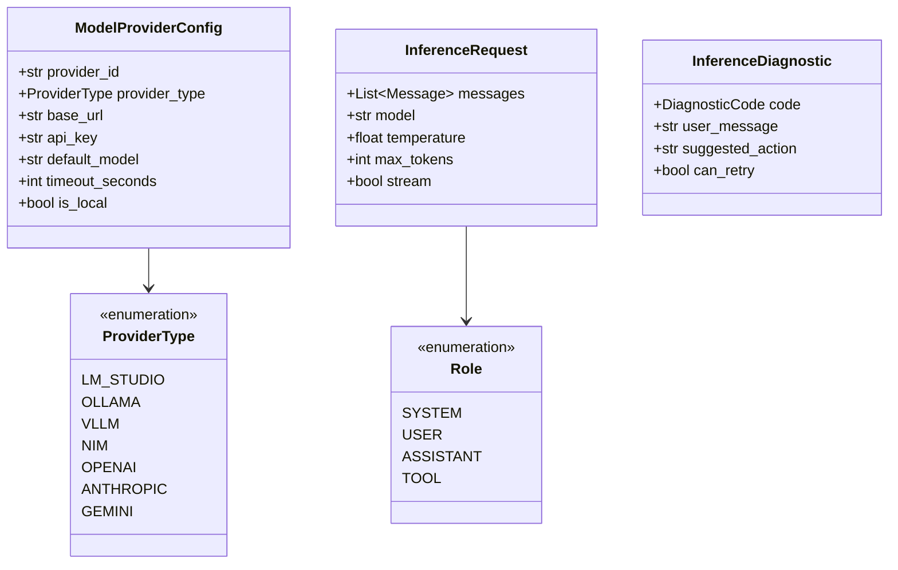
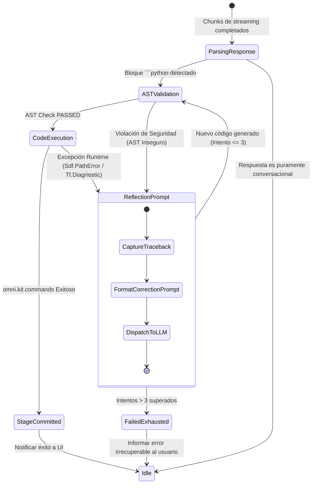
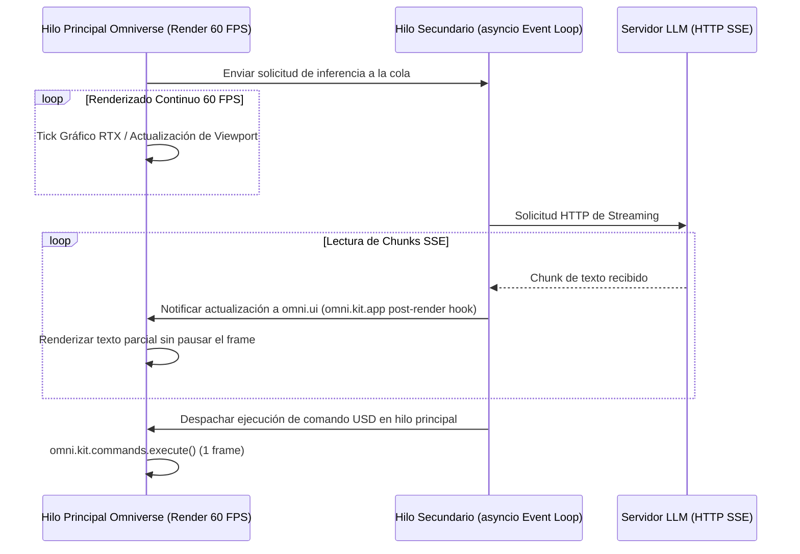

# 🔧 Documento de Diseño de Bajo Nivel (LLD)
# LM-Chat™ — Backend, Contratos de Componentes y Motor Espacial

---

## Control de Versiones del Documento

| Versión | Fecha | Autor | Rol | Estado | Resumen de Cambios |
| :--- | :--- | :--- | :--- | :--- | :--- |
| **1.0.0** | 2026-10-14 | Orlando Dorival | Lead Spatial AI Architect | Aprobado | Especificación formal de interfaces `core/interfaces.py`, modelos de datos, sandbox AST, máquina de estados ReAct y concurrencia 60 FPS. |

---

## 1. Alcance y Arquitectura de Paquetes

El paquete `omni.lm_chat` se descompone internamente en módulos cohesivos regidos por el principio de segregación de interfaces (*Interface Segregation Principle*):

```
omni.lm_chat/
├── __init__.py                 # Exportación de extensión y metadata __version__
├── extension.py                # Ciclo de vida on_startup / on_shutdown de Omniverse Kit
├── ui/
│   ├── chat_window.py          # Ventana principal omni.ui dockable
│   ├── chat_canvas.py          # ScrollFrame con burbujas de mensajes y markdown
│   ├── settings_view.py        # Acordeón de configuración de proveedores y modelos
│   └── styles.py               # Tokens de diseño y estilos UI (Obsidian & Emerald)
└── core/
    ├── interfaces.py           # Contratos tipados abstractos (ABCs)
    ├── inference_router.py     # Enrutador asíncrono y despacho a proveedores
    ├── settings_manager.py     # Persistencia tipada sobre carb.settings
    ├── diagnostics.py          # Clasificación y diagnóstico de fallos de inferencia
    ├── prompt_registry.py      # Plantillas de sistema y directivas espaciales OpenUSD
    ├── react_engine.py         # Sandbox AST, ejecución de código y reflexión
    ├── usd_controller.py       # Consultas y mutaciones reversibles del USD Stage
    └── mcp_registry.py         # Orquestación de subprocesos y clientes MCP
```

---

## 2. Contratos e Interfaces Formulares (`core/interfaces.py`)

Para garantizar la independencia de implementaciones y permitir el desarrollo paralelo por agentes autónomos (Swarms / Jules), todas las dependencias se inyectan a través de contratos abstractos:

```python
from abc import ABC, abstractmethod
from typing import AsyncGenerator, Dict, List, Optional, Any
from dataclasses import dataclass

@dataclass
class Message:
    role: str  # "system", "user", "assistant", "tool"
    content: str
    name: Optional[str] = None
    tool_calls: Optional[List[Dict[str, Any]]] = None

@dataclass
class InferenceRequest:
    messages: List[Message]
    model: str
    temperature: float = 0.7
    max_tokens: int = 4096
    stream: bool = True
    system_prompt: Optional[str] = None

@dataclass
class ExecutionResult:
    success: bool
    output: str
    error_type: Optional[str] = None
    traceback_str: Optional[str] = None
    retries_count: int = 0

class IInferenceRouter(ABC):
    """Contrato del enrutador de inferencia multi-proveedor."""
    
    @abstractmethod
    async def stream_chat(
        self, request: InferenceRequest, provider_id: Optional[str] = None
    ) -> AsyncGenerator[str, None]:
        """Transmite chunks de texto en streaming token por token."""
        pass

    @abstractmethod
    async def fetch_remote_models(self, provider_id: str) -> List[str]:
        """Descubre dinámicamente los modelos disponibles en el endpoint activo."""
        pass

class ISettingsManager(ABC):
    """Contrato del gestor de persistencia de configuración."""
    
    @abstractmethod
    def get_setting(self, path: str, default: Any = None) -> Any:
        pass

    @abstractmethod
    def set_setting(self, path: str, value: Any) -> None:
        pass

    @abstractmethod
    def subscribe_to_change(self, path: str, callback: Any) -> None:
        pass

class IUSDController(ABC):
    """Contrato de inspección y mutación controlada del Stage OpenUSD."""
    
    @abstractmethod
    def get_current_stage(self) -> Any:
        """Retorna la instancia activa de pxr.Usd.Stage."""
        pass

    @abstractmethod
    def execute_command(self, command_name: str, **kwargs) -> bool:
        """Ejecuta una acción reversible mediante omni.kit.commands."""
        pass

    @abstractmethod
    def get_stage_summary(self) -> Dict[str, Any]:
        """Genera un resumen semántico de prims, luces y geometrías para el prompt."""
        pass

class IMCPClientRegistry(ABC):
    """Contrato del registro de herramientas Model Context Protocol."""
    
    @abstractmethod
    async def discover_tools(self) -> List[Dict[str, Any]]:
        """Recupera la lista consolidada de tools de todos los servidores MCP."""
        pass

    @abstractmethod
    async def call_tool(self, tool_name: str, arguments: Dict[str, Any]) -> Dict[str, Any]:
        """Invoca una tool externa y devuelve el payload de resultado."""
        pass
```

---

## 3. Modelos de Datos y Esquemas Tipados



### 3.1. Taxonomía de Códigos de Diagnóstico (`core/diagnostics.py`)
El motor de diagnóstico evalúa excepciones y clasifica la falla en códigos predecibles:

| Código | Significado | Causa Común | Acción Sugerida |
| :--- | :--- | :--- | :--- |
| `ERR_PROVIDER_OFFLINE` | Endpoint local inalcanzable (`ConnectionRefusedError`) | LM Studio / Ollama no ha iniciado el servidor local. | "Verifica que LM Studio esté corriendo y el servidor local en el puerto 1234 esté activo." |
| `ERR_UNAUTHORIZED` | Error HTTP 401 / 403 | API Key inválida o revocada en proveedores de nube. | "Revisa tu API Key en el panel de configuración de LM-Chat." |
| `ERR_TIMEOUT` | Timeout de lectura o conexión ($>30$ s) | Modelo saturado o GPU con VRAM colapsada. | "Reduce el tamaño de contexto o selecciona un modelo con menor cuantización." |
| `ERR_MODEL_NOT_FOUND` | Error HTTP 404 en el modelo solicitado | El modelo fue descargado o renombrado en el servidor local. | "Presiona el botón de refresco en la UI para re-detectar los modelos activos." |

---

## 4. Motor de Ejecución ReAct y Sandbox Estático (AST)

### 4.1. Análisis Estático de Árbol de Sintaxis (AST Safety Visitor)
Antes de enviar cualquier bloque de código Python generado por el LLM a la escena de Omniverse, el módulo `react_engine.py` ejecuta un pase de validación estricta sobre el Abstract Syntax Tree (AST):

```python
import ast

class SecurityASTVisitor(ast.NodeVisitor):
    """Audita el AST para impedir la ejecución de funciones peligrosas."""
    
    DISALLOWED_MODULES = {
        "os", "sys", "subprocess", "socket", "urllib", "requests", 
        "shutil", "builtins", "importlib", "ctypes"
    }
    
    DISALLOWED_CALLS = {
        "eval", "exec", "open", "__import__", "globals", "locals", 
        "compile", "breakpoint", "exit", "quit"
    }

    def visit_Import(self, node):
        for alias in node.names:
            base_module = alias.name.split(".")[0]
            if base_module in self.DISALLOWED_MODULES:
                raise PermissionError(f"Importación prohibida detectada: '{alias.name}'")
        self.generic_visit(node)

    def visit_ImportFrom(self, node):
        if node.module:
            base_module = node.module.split(".")[0]
            if base_module in self.DISALLOWED_MODULES:
                raise PermissionError(f"Importación 'from' prohibida detectada: '{node.module}'")
        self.generic_visit(node)

    def visit_Call(self, node):
        if isinstance(node.func, ast.Name):
            if node.func.id in self.DISALLOWED_CALLS:
                raise PermissionError(f"Llamada a función insegura bloqueada: '{node.func.id}()'")
        self.generic_visit(node)
```

### 4.2. Entorno de Ejecución Confinado y Mapeo Seguro
El código validado se ejecuta en un diccionario restringido donde solo se exponen módulos autorizados de computación espacial:

```python
SAFE_GLOBALS = {
    "__builtins__": {
        "range": range, "len": len, "float": float, "int": int, "str": str,
        "bool": bool, "list": list, "dict": dict, "enumerate": enumerate,
        "print": lambda *args: carb.log_info(f"[LM-Chat Script] {' '.join(map(str, args))}"),
        "math": __import__("math")
    },
    "pxr": __import__("pxr"),
    "Usd": __import__("pxr.Usd").Usd,
    "UsdGeom": __import__("pxr.UsdGeom").UsdGeom,
    "UsdLux": __import__("pxr.UsdLux").UsdLux,
    "Sdf": __import__("pxr.Sdf").Sdf,
    "Gf": __import__("pxr.Gf").Gf,
    "omni": __import__("omni"),
    "omni.kit.commands": __import__("omni.kit.commands")
}
```

### 4.3. Máquina de Estados ReAct y Ciclo de Auto-Reparación



---

## 5. Modelo de Hilos y Concurrencia de 60 FPS

Para preservar el Invariante 2, la arquitectura utiliza una cola de despacho asíncrona que comunica el hilo de trabajo de `asyncio` con el hilo de renderizado principal de Omniverse Kit:



---

## 6. Jerarquía de Excepciones del Sistema

Todas las excepciones heredan de `LMChatBaseException` para permitir captura granular en el núcleo:

```
LMChatBaseException
├── InferenceException
│   ├── ProviderConnectionError
│   ├── ProviderAuthenticationError
│   ├── ModelNotFoundError
│   └── InferenceTimeoutError
├── SecurityException
│   ├── ASTSecurityViolationError
│   └── DisallowedModuleAccessError
├── SpatialUSDException
│   ├── SdfPathResolutionError
│   ├── PrimMutationError
│   └── UndoStackCorruptedError
└── ReActExhaustionException
```
