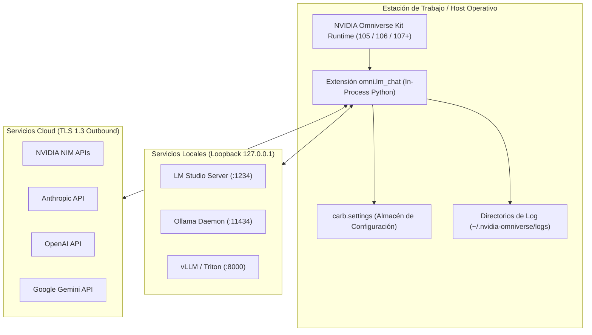
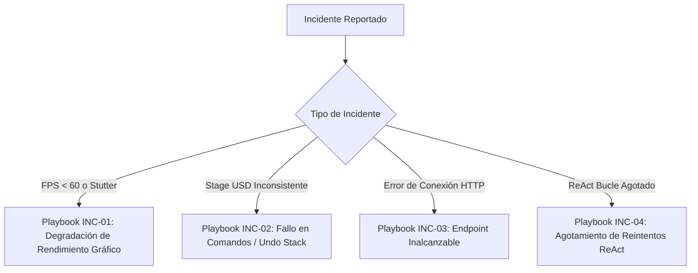

# 🛠️ Manual de Operaciones y Mantenimiento SRE (Operations Runbook)
# LM-Chat™ — Autonomous Spatial AI Copilot for NVIDIA Omniverse

---

## Control de Versiones del Documento

| Versión | Fecha | Autor | Rol | Estado | Resumen de Cambios |
| :--- | :--- | :--- | :--- | :--- | :--- |
| **1.0.0** | 2026-10-14 | Orlando Dorival | Lead DevOps & SRE Engineer | Aprobado | Matriz de variables de configuración, empaquetado para Omniverse Kit, playbooks de incidentes INC-01 a INC-04 y diagnóstico. |

---

## 1. Resumen Operacional y Topología de Ejecución

**LM-Chat™** opera como una extensión oficial de **NVIDIA Omniverse™ Kit SDK** identificada como `omni.lm_chat`. 

A diferencia de las aplicaciones web convencionales basadas en Kubernetes o microservicios en la nube, el entorno operativo de LM-Chat reside dentro del proceso cliente de Omniverse en la estación de trabajo del usuario (Workstation / Cloud Instance RTX), integrándose estrechamente con el gestor de memoria C++ de Omniverse y el bucle de eventos asíncrono.



---

## 2. Matriz de Variables de Configuración y Claves (`carb.settings`)

La configuración se almacena en el árbol jerárquico de `carb.settings` bajo la ruta `/exts/omni.lm_chat/`. Puede ser modificada mediante la interfaz gráfica, el archivo `config/extension.toml` o variables de entorno del sistema operativo.

| Ruta de Configuración (`carb.settings`) | Variable de Entorno Equivalente | Tipo | Valor Predeterminado | Descripción |
| :--- | :--- | :--- | :--- | :--- |
| `/exts/omni.lm_chat/active_provider` | `LMCHAT_ACTIVE_PROVIDER` | `string` | `"lm_studio"` | Proveedor activo por defecto (`lm_studio`, `ollama`, `vllm`, `nim`, `openai`, `anthropic`, `gemini`). |
| `/exts/omni.lm_chat/lm_studio/base_url` | `LMCHAT_LM_STUDIO_URL` | `string` | `"http://127.0.0.1:1234"` | Endpoint base del servidor local de LM Studio. |
| `/exts/omni.lm_chat/ollama/base_url` | `LMCHAT_OLLAMA_URL` | `string` | `"http://127.0.0.1:11434"` | Endpoint base del daemon de Ollama. |
| `/exts/omni.lm_chat/vllm/base_url` | `LMCHAT_VLLM_URL` | `string` | `"http://127.0.0.1:8000"` | Endpoint base del servidor vLLM OpenAI-compatible. |
| `/exts/omni.lm_chat/openai/api_key` | `OPENAI_API_KEY` | `string` | `""` | Clave de API de OpenAI (almacenada en almacén protegido). |
| `/exts/omni.lm_chat/anthropic/api_key` | `ANTHROPIC_API_KEY` | `string` | `""` | Clave de API de Anthropic. |
| `/exts/omni.lm_chat/gemini/api_key` | `GEMINI_API_KEY` | `string` | `""` | Clave de API de Google Gemini. |
| `/exts/omni.lm_chat/react/max_retries` | `LMCHAT_MAX_RETRIES` | `int` | `3` | Número máximo de reintentos autónomos de auto-reparación ReAct. |
| `/exts/omni.lm_chat/timeout_seconds` | `LMCHAT_TIMEOUT` | `int` | `30` | Límite de tiempo en segundos para conexiones de inferencia. |
| `/exts/omni.lm_chat/ast/strict_mode` | `LMCHAT_AST_STRICT` | `bool` | `true` | Habilita el bloqueo estricto de llamadas de sistema en scripts generados. |

---

## 3. Empaquetado y Pipeline de Distribución para Omniverse Kit

### 3.1. Regla Invariante de Empaquetado
NVIDIA Omniverse Kit requiere que los paquetes ZIP de extensiones contengan una carpeta raíz de nivel superior nombrada **estrictamente `omni.lm_chat/`** (sin números de versión ni sufijos dinámicos en el nombre del directorio raíz).

```
omni.lm_chat.zip
└── omni.lm_chat/
    ├── extension.toml
    ├── __init__.py
    ├── ui/
    ├── core/
    └── docs/
```

### 3.2. Procedimiento de Lanzamiento Automatizado (Release Pipeline)
El ciclo de lanzamiento está gobernado por el script universal `scripts/release.py` y `Commitizen`:

```bash
# Paso 1: Ejecutar verificación de sanidad y simulación (Dry Run)
python scripts/release.py patch --dry-run

# Paso 2: Ejecutar el incremento de versión real (sincroniza los 5 archivos)
python scripts/release.py patch --commit --tag

# Paso 3: Publicar rama y tags a GitHub
git push origin feat/nueva-version --tags
```

---

## 4. Diagnóstico de Salud y Health Checks

### 4.1. Verificación de Conectividad con Proveedores Locales
Si la extensión reporta errores de conexión, ejecute las siguientes verificaciones en la terminal del host:

```bash
# 1. Probar conectividad con LM Studio
curl -s http://127.0.0.1:1234/v1/models | jq .

# 2. Probar conectividad con Ollama
curl -s http://127.0.0.1:11434/api/tags | jq .

# 3. Probar conectividad con vLLM
curl -s http://127.0.0.1:8000/v1/models | jq .
```

### 4.2. Inspección de Logs en Omniverse Kit
Los logs de Omniverse se localizan de forma predeterminada en:
- **Windows:** `%USERPROFILE%\.nvidia-omniverse\logs\Kit\OmniverseCode\`
- **Linux:** `~/.nvidia-omniverse/logs/Kit/OmniverseCode/`

Comando para filtrar eventos de LM-Chat en tiempo real:
```powershell
# PowerShell en Windows
Get-Content -Path "$env:USERPROFILE\.nvidia-omniverse\logs\Kit\USD.Composer\*.log" -Tail 100 -Wait | Select-String "omni.lm_chat"
```

---

## 5. Playbooks de Respuesta a Incidentes (Incident Playbooks)



### INC-01: Caída de Tasa de Cuadros en Viewport ($< 60$ FPS)
- **Severidad:** P1 (Alta).
- **Síntoma:** El viewport 3D de Omniverse experimenta tirones durante la recepción de respuestas del modelo.
- **Diagnóstico:**
  1. Abrir el Profiler de Omniverse (`Window > Diagnostics > Profiler`).
  2. Verificar si el hilo principal (`Main Thread`) presenta llamadas síncronas a `urllib`, `requests` o bucles `time.sleep()`.
  3. Comprobar si se están realizando mutaciones de la UI en cada token individual en vez de usar batches de actualización.
- **Remediación:**
  1. Asegurar que `stream_chat()` utilice `asyncio.sleep(0)` para ceder el control del bucle de eventos.
  2. Activar el limitador de refresco de UI (`UI_THROTTLE_MS = 33` ms) para agrupar tokens entrantes antes de re-renderizar el `omni.ui.Label`.

### INC-02: Desincronización o Fallo del Historial de Deshacer (Undo Stack)
- **Severidad:** P0 (Crítica).
- **Síntoma:** El usuario presiona `Ctrl+Z` y la escena no revierte las modificaciones creadas por la IA o el Stage se bloquea.
- **Diagnóstico:**
  1. Buscar en los logs llamadas directas a métodos como `stage.DefinePrim()` fuera de `omni.kit.commands`.
  2. Revisar si la excepción en el comando interrumpió el cierre del bloque `UndoGroup`.
- **Remediación:**
  1. Revertir temporalmente la escena al último punto de guardado mediante `omni.usd.get_context().reopen_stage()`.
  2. Envolver la llamada conflictiva en `omni.kit.commands.execute("CreatePrimWithUndo", ...)` y reiniciar la extensión.

### INC-03: Endpoint Inalcanzable (`ERR_PROVIDER_OFFLINE`)
- **Severidad:** P2 (Media).
- **Síntoma:** LM-Chat muestra una alerta indicando que no puede conectar con el servidor local.
- **Diagnóstico:**
  1. Validar si el puerto local (`1234` o `11434`) está en escucha: `netstat -ano | findstr "1234"`.
  2. Verificar si el firewall local o antivirus bloquea la comunicación loopback.
- **Remediación:**
  1. En LM Studio, navegar a la pestaña "Local Server" y presionar "Start Server" verificando que "Cross-Origin-Resource-Sharing (CORS)" esté habilitado.
  2. En Ollama, reiniciar el servicio con `ollama serve`.

### INC-04: Agotamiento de Reintentos ReAct (`ReActMaxRetriesExceeded`)
- **Severidad:** P2 (Media).
- **Síntoma:** El modelo falla repetidamente en generar código funcional tras 3 intentos.
- **Diagnóstico:**
  1. Inspeccionar el prompt de reflexión enviado al modelo en los logs de depuración.
  2. Comprobar si el modelo seleccionado carece de capacidades de codificación en Python (e.g. modelos pequeños $<3B$ de parámetros).
- **Remediación:**
  1. El sistema detiene el bucle de forma limpia, preserva el Stage intacto y notifica al usuario en la UI.
  2. Recomendar al usuario utilizar un modelo con mayor capacidad de razonamiento espacial (e.g. Qwen 2.5 Coder 7B+, DeepSeek Coder o Claude 3.5 Sonnet).

---

## 6. Mantenimiento y Rotación de Caché

Para prevenir la acumulación de archivos temporales:
1. **Caché de Descubrimiento de Modelos:** El catálogo remoto se invalida tras 300 segundos (5 minutos) o inmediatamente cuando el usuario pulsa el botón de refresco en la UI.
2. **Historial de Chat de Sesión:** Las sesiones de chat se almacenan en memoria volátil por defecto y se depuran al cerrar la ventana o ejecutar `on_shutdown()`, garantizando que no queden datos sensibles en disco a menos que el usuario exporte explícitamente la conversación.
