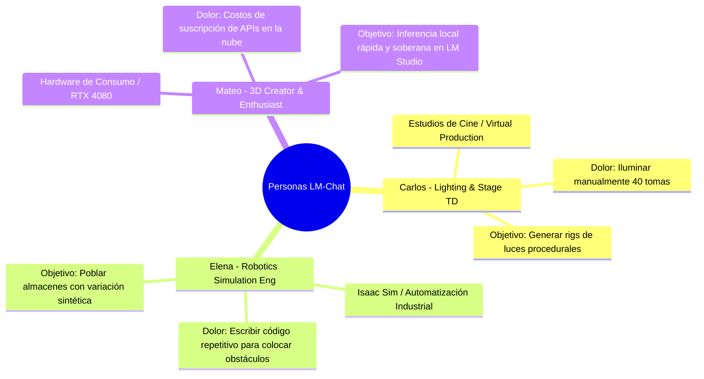

# 📋 Documento de Requerimientos de Producto (PRD)
# LM-Chat™ — Autonomous Spatial AI Copilot for NVIDIA Omniverse

---

## Control de Versiones del Documento

| Versión | Fecha | Autor | Rol | Estado | Resumen de Cambios |
| :--- | :--- | :--- | :--- | :--- | :--- |
| **1.0.0** | 2026-10-14 | Orlando Dorival | Lead Product & AI Architect | Aprobado | Línea base del PRD: Definición de visión, Personas, Matriz MoSCoW (Must, Should, Could, Won't) y Criterios Given-When-Then. |

---

## 1. Visión del Producto y Declaración del Problema

### 1.1. El Problema en la Industria 3D y Simulación
El desarrollo de gemelos digitales, mundos virtuales y escenarios de entrenamiento robótico sobre la especificación **Universal Scene Description (OpenUSD)** de Pixar y NVIDIA Omniverse exige un conocimiento profundo y especializado de APIs complejas en Python (`pxr.Usd`, `pxr.Sdf`, `omni.kit.commands`). 

Los artistas técnicos, diseñadores y científicos de datos experimentan cuellos de botella severos:
- **Fricción Sintáctica:** Crear jerarquías complejas, configurar transformaciones espaciales matriciales ($4\times4$) y asociar materiales MDL requiere docenas de líneas de código propenso a errores de ruta (`Sdf.Path`).
- **Interrupción del Flujo Creativo:** La alternancia constante entre el Viewport 3D y la documentación técnica destruye la cadencia de trabajo.
- **Riesgo de Corrupción del Stage:** La manipulación descuidada de grafos de escena puede corromper capas de USD o eliminar el historial de deshacer (`Ctrl+Z`).
- **Dependencia de la Nube:** Muchas empresas con propiedad intelectual confidencial (diseño automotriz, aeroespacial, manufactura) tienen prohibido enviar datos de escenas a APIs externas.

### 1.2. La Propuesta de Valor de LM-Chat™
**LM-Chat™** es un copiloto de inteligencia artificial espacial embebido directamente en la interfaz de NVIDIA Omniverse que permite a los usuarios **conversar con su escena 3D en lenguaje natural**, orquestar mutaciones de OpenUSD en tiempo real mediante comandos no-destructivos y auto-corregir fallos de ejecución de forma transparente, admitiendo tanto inferencia soberana 100% local (LM Studio, Ollama, vLLM) como modelos de frontera en la nube (OpenAI, Anthropic Claude, Google Gemini).

---

## 2. Arquetipos de Usuario (User Personas)



### Persona 1: Carlos — Director Técnico de Iluminación y Escenario (Stage TD)
- **Rol:** Senior Technical Director en un estudio de producción virtual.
- **Plataforma:** Omniverse USD Composer sobre workstation con NVIDIA RTX 6000 Ada.
- **Objetivo:** Automatizar la creación de setups de iluminación de tres puntos, asignar shaders MDL de metales y verificar intensidades en lúmenes.
- **Frustración:** Escribir scripts repetitivos para buscar prims en el árbol de escena y ajustar manualmente matrices de rotación en prims de tipo `DistantLight`.

### Persona 2: Elena — Ingeniera de Robótica y Simulación (Robotics Engineer)
- **Rol:** Desarrolladora de IA y robótica en NVIDIA Isaac Sim.
- **Plataforma:** Omniverse Isaac Sim en Ubuntu 22.04 LTS.
- **Objetivo:** Generar proceduralmente escenarios de almacén con estanterías, palets y cajas en posiciones aleatorias con física rígida activa (`UsdPhysics.RigidBodyAPI`).
- **Frustración:** Cuando un script genera una ruta inválida en OpenUSD, Isaac Sim arroja advertencias crípticas en consola y la ejecución se aborta.

### Persona 3: Mateo — Creador 3D y Entusiasta Local (Indie Creator)
- **Rol:** Artista 3D independiente y desarrollador interactivo.
- **Plataforma:** Windows 11 con GPU RTX 4070 Ti, utilizando LM Studio y modelos cuantizados Q4_K_M.
- **Objetivo:** Modelar y experimentar en Omniverse sin incurrir en costos de tokens de APIs en la nube y con privacidad total de sus proyectos.
- **Frustración:** Las extensiones comerciales de IA requieren claves de OpenAI pagadas y fallan si no hay conexión a internet.

---

## 3. Matriz de Requerimientos Funcionales (MoSCoW)

### 3.1. Must Have (Requerimientos Críticos de Lanzamiento)

| ID | Nombre del Requerimiento | Descripción | Prioridad |
| :--- | :--- | :--- | :--- |
| **RF-M01** | **Enrutamiento Multi-Proveedor** | Soporte nativo para alternar entre LM Studio (1234), Ollama (11434), vLLM (8000), NVIDIA NIM, OpenAI, Anthropic Claude y Google Gemini. | P0 (Must) |
| **RF-M02** | **Interfaz Gráfica de Chat en omni.ui** | Ventana acoplable (dockable) integrada en Omniverse con streaming de tokens en tiempo real, formateo Markdown y renderizado de bloques de código con resaltado sintáctico. | P0 (Must) |
| **RF-M03** | **Mutaciones No-Destructivas OpenUSD** | Todo cambio ejecutado en la escena debe envolverse obligatoriamente en `omni.kit.commands.execute()`, garantizando compatibilidad total con `Ctrl+Z` (Undo) y `Ctrl+Y` (Redo). | P0 (Must) |
| **RF-M04** | **Bucle ReAct con Auto-Reparación** | Intercepción automática de excepciones Python y diagnósticos `Tf.DiagnosticMark` en scripts generados, construyendo un prompt de reflexión interna para auto-corregir el código hasta en 3 intentos. | P0 (Must) |
| **RF-M05** | **Descubrimiento Dinámico de Modelos** | Consulta en tiempo de ejecución a endpoints (`/v1/models`, `/api/tags`) para actualizar el selector de modelos de la UI sin necesidad de reiniciar la extensión ni depender de listas estáticas. | P0 (Must) |
| **RF-M06** | **Sandbox de Seguridad AST** | Análisis estático del código Python generado antes de su ejecución para bloquear `os.system`, `subprocess`, `open`, `eval` y módulos de exfiltración de red. | P0 (Must) |

### 3.2. Should Have (Requerimientos de Alto Valor)

| ID | Nombre del Requerimiento | Descripción | Prioridad |
| :--- | :--- | :--- | :--- |
| **RF-S01** | **Inyección de Contexto del Stage** | Capacidad de leer la selección actual de prims en el viewport, transformaciones de la cámara activa y resumen de la jerarquía USD para enriquecer el contexto del prompt. | P1 (Should) |
| **RF-S02** | **Interoperabilidad con Model Context Protocol (MCP)** | Conector cliente para servidores MCP (JSON-RPC stdio/SSE) para permitir que el modelo invoque herramientas externas (lectura de metadatos CAD, búsquedas locales). | P1 (Should) |
| **RF-S03** | **Interfaz de Línea de Comandos (CLI Headless)** | CLI interactivo (`cli/lmchat_cli.py`) para operar el motor de LM-Chat desde terminales sin interfaz gráfica o en pipelines de automatización continua. | P1 (Should) |

### 3.3. Could Have (Requerimientos Deseables a Futuro)

| ID | Nombre del Requerimiento | Descripción | Prioridad |
| :--- | :--- | :--- | :--- |
| **RF-C01** | **Entrada de Voz Local (Whisper STT)** | Dictado de instrucciones espaciales por voz transcritas localmente en GPU mediante whisper.cpp. | P2 (Could) |
| **RF-C02** | **Enjambre Multi-Agente en Escena** | Despacho simultáneo de tareas a múltiples agentes especializados (Agente de Iluminación, Agente de Físicas, Agente de Shaders). | P2 (Could) |

### 3.4. Won't Have (Fuera de Alcance para esta Versión)

| ID | Nombre del Requerimiento | Razón de Exclusión |
| :--- | :--- | :--- |
| **RF-W01** | **Esculpido Booleano de Mallas a Nivel de Vértices** | Operación computacionalmente destructiva no recomendada para pipelines basados en capas USD estándar. |
| **RF-W02** | **Suscripciones Propietarias de Nube Cerradas** | LM-Chat promueve el código abierto y la soberanía de cómputo local del usuario. |

---

## 4. Requisitos No Funcionales (RNF)

1. **RNF-01 — Bucle Sagrado de 60 FPS:** Ninguna operación de inferencia o serialización de red puede reducir la tasa de cuadros del viewport por debajo de 60 FPS ($\le 16.6$ ms por cuadro).
2. **RNF-02 — Soberanía y Privacidad de Datos:** En modo local (LM Studio / Ollama), cero bytes de datos del usuario o del Stage USD abandonan el host (`127.0.0.1`).
3. **RNF-03 — Compatibilidad Multiplataforma:** La extensión debe funcionar de forma idéntica en Windows 11 (build 22621+) y Ubuntu Linux 22.04 LTS con NVIDIA Driver 535+.
4. **RNF-04 — Convivencia con el Ecosistema Python de Omniverse:** Prohibido instalar paquetes globales mediante `pip` que rompan las bibliotecas base de Omniverse Kit (`pxr.Usd`, `carb`, `omni.ui`).

---

## 5. Criterios de Aceptación (Gherkin: Given-When-Then)

### Escenario 1: Creación de Primitiva USD Mediante Modelo Local
```gherkin
Feature: Generación de Primitivas OpenUSD
  Scenario: Creación exitosa de un foco SphereLight en la escena activa
    Given que el usuario tiene activo el proveedor "LM Studio" en http://127.0.0.1:1234
      And el Stage USD de Omniverse está cargado con un prim raíz "/World"
    When el usuario ingresa en el chat: "Crea una luz esférica llamada KeyLight con radio 2.5 en /World/Lights"
    Then el modelo genera un bloque de código Python seguro
      And el Sandbox AST valida que no existen llamadas prohibidas
      And el sistema ejecuta el comando a través de omni.kit.commands.execute()
      And el prim "/World/Lights/KeyLight" aparece visible en el Viewport
      And la operación se registra en la pila de deshacer nativa de Omniverse (Ctrl+Z)
```

### Escenario 2: Auto-Reparación Autónoma ReAct ante Error de Ruta USD
```gherkin
Feature: Bucle ReAct y Autocuración de Errores
  Scenario: Recuperación automática tras un error de conflicto de ruta en el Stage
    Given que ya existe un prim en la ruta "/World/Props/Caja"
    When el usuario solicita: "Añade una caja en /World/Props/Caja"
      And el modelo genera inicialmente un código que intenta crear el prim en la misma ruta
      And la ejecución de OpenUSD arroja una excepción "Sdf.PathError: Prim already exists"
    Then el motor ReAct intercepta la excepción antes de que afecte la UI
      And construye un prompt de reflexión con el traceback exacto
      And consulta nuevamente al modelo solicitando una ruta alternativa no colisionante
      And el modelo entrega código corregido usando "/World/Props/Caja_01"
      And el prim se crea exitosamente en el segundo intento
      And la UI muestra un indicador informativo: "Acción completada con 1 auto-corrección"
```

### Escenario 3: Deshacer Cambios con Ctrl+Z
```gherkin
Feature: Integridad del Historial de Escena
  Scenario: Reversión completa de un conjunto de luces creadas por la IA
    Given que el usuario solicitó crear un rig de 3 luces y estas se crearon en la escena
    When el usuario presiona "Ctrl+Z" en el viewport de Omniverse
    Then las 3 luces desaparecen del Stage y de la jerarquía de prims
    When el usuario presiona "Ctrl+Y"
    Then las 3 luces se restauran exactamente con sus atributos previos
```

### Escenario 4: Conexión Caída de Proveedor Local
```gherkin
Feature: Diagnóstico de Conectividad
  Scenario: Notificación clara al usuario cuando el servidor local está apagado
    Given que el usuario configuró "Ollama" en el puerto 11434 pero el servicio está inactivo
    When el usuario envía una consulta en el chat
    Then el enrutador de inferencia detecta ConnectionRefusedError en menos de 2 segundos
      And no se produce congelamiento en la UI
      And se renderiza una tarjeta de diagnóstico con código ERR_PROVIDER_OFFLINE
      And se ofrece una sugerencia clara: "Inicia Ollama ejecutando 'ollama serve' en tu terminal"
```
