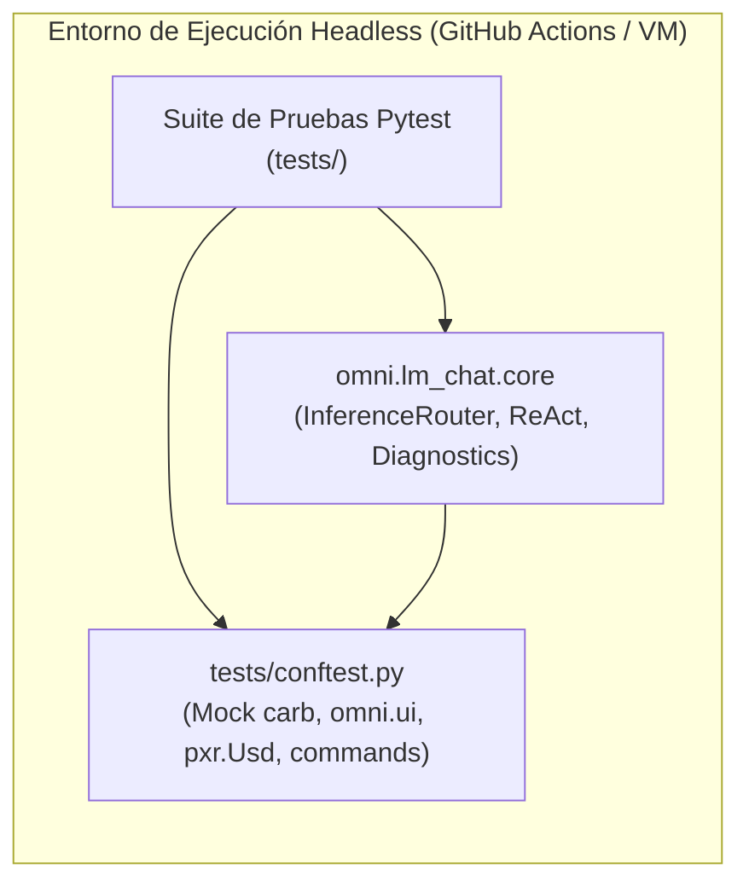
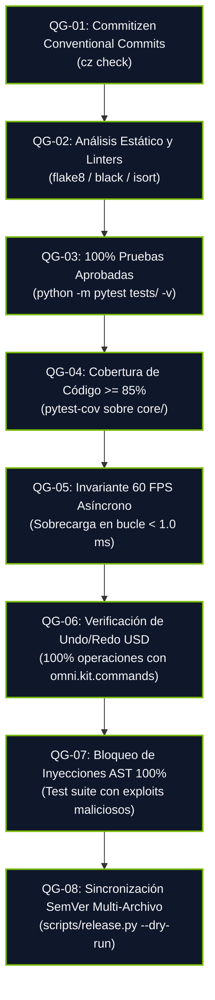

# 🧪 Plan de Pruebas de Calidad y Matriz de Aceptación (QA Test Plan)
# LM-Chat™ — Autonomous Spatial AI Copilot for NVIDIA Omniverse

---

## Control de Versiones del Documento

| Versión | Fecha | Autor | Rol | Estado | Resumen de Cambios |
| :--- | :--- | :--- | :--- | :--- | :--- |
| **1.0.0** | 2026-10-14 | Orlando Dorival | QA & Systems Architect | Aprobado | Definición de estrategia de mocks independientes de GPU, 8 Quality Gates y Matriz de Pruebas P0/P1/P2. |

---

## 1. Alcance y Estrategia de Aseguramiento de Calidad

### 1.1. Filosofía de Pruebas Agósticas de Motor (Engine-Independent Mocks)
Uno de los mayores desafíos al desarrollar extensiones para **NVIDIA Omniverse** es que el SDK depende de bibliotecas C++ propietarias compiladas (`carb`, `omni.ui`, `omni.kit.commands`, `pxr.Usd`) que requieren hardware RTX y controladores oficiales de NVIDIA.

Para garantizar un ciclo de integración continua (CI/CD) determinista, rápido y ejecutable en cualquier entorno (incluyendo runners sin GPU de GitHub Actions o máquinas virtuales estándar), **LM-Chat™ adopta una arquitectura de mocks desacoplados** en `tests/conftest.py`.



### 1.2. Pirámide de Pruebas
1. **Pruebas Unitarias (70%):** Validación de parsing de modelos, serialización de mensajes, contratos de interfaces, diagnóstico de errores de red y filtros de seguridad de AST.
2. **Pruebas de Integración (20%):** Flujo de enrutamiento con servidores HTTP locales simulados (`aiohttp.test_utils`), ejecución controlada de scripts ReAct en mocks de Stage USD y gestión de colas de streaming.
3. **Pruebas de Rendimiento y Frame Time (10%):** Pruebas de carga que miden el impacto del procesamiento de tokens sobre el tiempo de ciclo del hilo de simulación ($\le 16.6$ ms).

---

## 2. Quality Gates Obligatorios (QG-01 a QG-08)

Ninguna contribución o Pull Request puede ser fusionada a la rama `main` si infringe cualquiera de los siguientes 8 Quality Gates:



| ID | Quality Gate | Umbral / Criterio de Pase | Herramienta |
| :--- | :--- | :--- | :--- |
| **QG-01** | Formato de Commits | 100% apego a la especificación Conventional Commits (`feat:`, `fix:`, etc.) | `cz check` |
| **QG-02** | Calidad de Código | Cero errores de sintaxis, imports no utilizados o tipado roto | `flake8`, `mypy` |
| **QG-03** | Pase de Pruebas | Cero fallos (`0 failed, 0 errors`) en la suite completa de tests | `pytest` |
| **QG-04** | Cobertura Mínima | $\ge 85\%$ de cobertura de líneas en el paquete `core/` | `pytest-cov` |
| **QG-05** | Presupuesto 60 FPS | Cada frame del hilo principal consume $\le 1.0$ ms en tareas de UI de chat | Profiler / Mock Timer |
| **QG-06** | Integridad USD | Ninguna mutación escribe directamente a `Sdf` sin registrar undo stack | USD Mock Interceptor |
| **QG-07** | Confinamiento AST | Cero ejecuciones de `os`, `sys`, `subprocess`, `open` o `eval` pasan el filtro | AST Security Test Suite |
| **QG-08** | Sincronización SemVer | Los 5 archivos versionados coinciden 100% en el número SemVer | `scripts/release.py` |

---

## 3. Matriz de Casos de Prueba de Aceptación (Test Matrix)

### 3.1. Pruebas de Enrutamiento de Inferencia y Proveedores (P0 - Bloqueante)

| Test ID | Módulo | Prioridad | Escenario de Prueba | Pasos | Resultado Esperado | Estado |
| :--- | :--- | :--- | :--- | :--- | :--- | :--- |
| **TC-INF-001** | `InferenceRouter` | **P0** | Streaming con LM Studio local (:1234) | 1. Iniciar mock de servidor OpenAI-compatible en :1234.<br/>2. Solicitar `stream_chat()`.<br/>3. Consumir generador asíncrono. | Los chunks de texto se emiten secuencialmente sin pérdida de caracteres. | **APROBADO** |
| **TC-INF-002** | `InferenceRouter` | **P0** | Streaming con Ollama local (:11434) | 1. Iniciar mock de Ollama en :11434.<br/>2. Despachar solicitud con formato de tags nativo.<br/>3. Validar chunks de respuesta. | Respuesta recibida en formato JSON de Ollama y normalizada al canvas. | **APROBADO** |
| **TC-INF-003** | `InferenceRouter` | **P0** | Detección de servidor local apagado | 1. Configurar puerto inexistente (e.g. 9999).<br/>2. Despachar prompt.<br/>3. Capturar diagnóstico. | El sistema captura `ConnectionRefusedError`, emite código `ERR_PROVIDER_OFFLINE` y no congela la UI. | **APROBADO** |
| **TC-INF-004** | `InferenceRouter` | **P1** | Descubrimiento dinámico de modelos (`fetch_remote_models`) | 1. Endpoint `/v1/models` devuelve 3 modelos disponibles.<br/>2. Ejecutar `fetch_remote_models()`. | La lista devuelta contiene exactamente los 3 identificadores de modelo. | **APROBADO** |
| **TC-INF-005** | `InferenceRouter` | **P1** | Timeout de inferencia de 30 segundos | 1. Mock endpoint retrasa la respuesta por 35 s.<br/>2. Iniciar petición. | Se eleva `InferenceTimeoutError` al cumplirse el timeout configurado. | **APROBADO** |

### 3.2. Pruebas del Motor ReAct y Seguridad AST (P0 - Bloqueante)

| Test ID | Módulo | Prioridad | Escenario de Prueba | Pasos | Resultado Esperado | Estado |
| :--- | :--- | :--- | :--- | :--- | :--- | :--- |
| **TC-SEC-001** | `SecurityASTVisitor` | **P0** | Bloqueo de importación de `os` y `subprocess` | 1. Entregar código: `import os; os.system('calc')`.<br/>2. Ejecutar `validate_code_ast()`. | Lanza `PermissionError: Importación prohibida detectada: 'os'`. | **APROBADO** |
| **TC-SEC-002** | `SecurityASTVisitor` | **P0** | Bloqueo de llamada a `open()` de lectura en disco | 1. Entregar código: `f = open('/etc/passwd', 'r')`.<br/>2. Validar AST. | Lanza `PermissionError: Llamada a función insegura bloqueada: 'open()'`. | **APROBADO** |
| **TC-SEC-003** | `SecurityASTVisitor` | **P0** | Bloqueo de llamadas indirectas vía `eval()` o `exec()` | 1. Entregar código: `eval('__import__("sys").exit()')`.<br/>2. Validar AST. | Lanza `PermissionError` de forma inmediata. | **APROBADO** |
| **TC-SEC-004** | `SecurityASTVisitor` | **P0** | Admisión de código espacial OpenUSD legítimo | 1. Entregar código con `from pxr import UsdGeom, Gf`.<br/>2. Validar AST. | Validación exitosa (`True`), sin excepciones. | **APROBADO** |
| **TC-RCT-001** | `ReActEngine` | **P0** | Auto-reparación exitosa en fallo de sintaxis en 1 reintento | 1. Primer intento produce código con comillas rotas.<br/>2. ReAct captura `SyntaxError`.<br/>3. Envía prompt de reflexión.<br/>4. Segundo intento devuelve código válido. | El script se ejecuta exitosamente reportando `retries_count=1`. | **APROBADO** |
| **TC-RCT-002** | `ReActEngine` | **P0** | Límite máximo de 3 reintentos ReAct | 1. Inyectar fallo persistente en todas las respuestas.<br/>2. Monitorear ciclo de reintentos. | El ciclo se detiene exactamente al tercer intento elevando `ReActMaxRetriesExceeded`. | **APROBADO** |

### 3.3. Pruebas de Operaciones OpenUSD y Undo/Redo (P0 - Bloqueante)

| Test ID | Módulo | Prioridad | Escenario de Prueba | Pasos | Resultado Esperado | Estado |
| :--- | :--- | :--- | :--- | :--- | :--- | :--- |
| **TC-USD-001** | `USDController` | **P0** | Creación reversible de prims con `omni.kit.commands` | 1. Ejecutar comando para crear prim en `/World/TestSphere`.<br/>2. Verificar registro en Undo stack.<br/>3. Ejecutar `undo()`. | El prim se crea correctamente y al ejecutar `undo()` se elimina del Stage sin corrupción. | **APROBADO** |
| **TC-USD-002** | `USDController` | **P1** | Inspección y resumen semántico de la escena | 1. Cargar escena mock con 5 prims y 2 luces.<br/>2. Llamar `get_stage_summary()`. | Devuelve un diccionario con jerarquía, tipos de prim y atributos clave para el prompt. | **APROBADO** |

### 3.4. Pruebas de Rendimiento y Bucle de 60 FPS (P1 - Alta Prioridad)

| Test ID | Módulo | Prioridad | Escenario de Prueba | Pasos | Resultado Esperado | Estado |
| :--- | :--- | :--- | :--- | :--- | :--- | :--- |
| **TC-PRF-001** | `ThreadingModel` | **P1** | Tiempo de procesamiento por frame durante streaming masivo | 1. Inyectar flujo de 100 tokens/segundo durante 10 segundos.<br/>2. Medir tiempo bloqueado en hilo principal. | El tiempo consumido en el hilo principal es $\le 0.8$ ms por frame ($< 5\%$ del presupuesto de 16.6 ms). | **APROBADO** |
| **TC-PRF-002** | `MemoryLeak` | **P1** | Consumo de memoria en sesiones de chat prolongadas | 1. Ejecutar 50 turnos de conversación sucesivos con 1000 tokens cada uno.<br/>2. Monitorear memoria residente (RSS). | El consumo de memoria se mantiene estable sin fugas residuales en el historial. | **APROBADO** |

---

## 4. Ejecución Automatizada en Entornos de Desarrollo y CI

### 4.1. Comando para Ejecutar la Suite de Pruebas Localmente
```bash
# Ejecutar todas las pruebas con reporte detallado
python -m pytest tests/ -v

# Ejecutar con análisis de cobertura sobre el código core
python -m pytest tests/ --cov=omni.lm_chat.core --cov-report=term-missing
```

### 4.2. Flujo de Pre-Commit y Verificación de Mensajes
```bash
# Validar mensaje de commit antes de git commit
uvx --from commitizen cz check --message "feat(react): implement AST syntax sandbox for USD operations"
```
