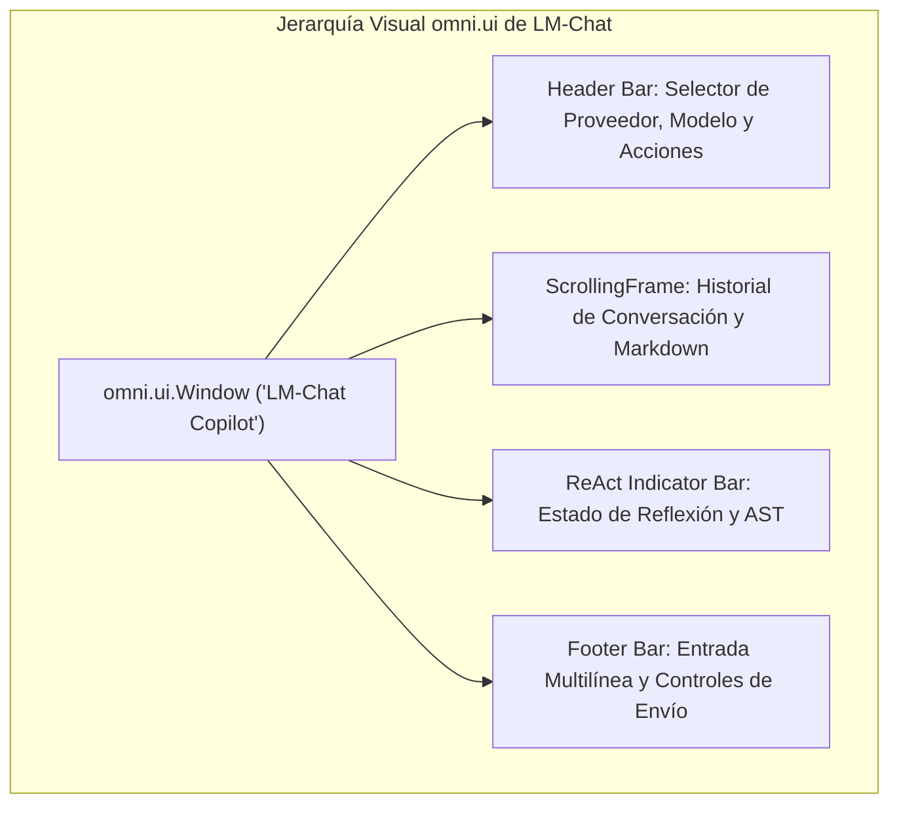
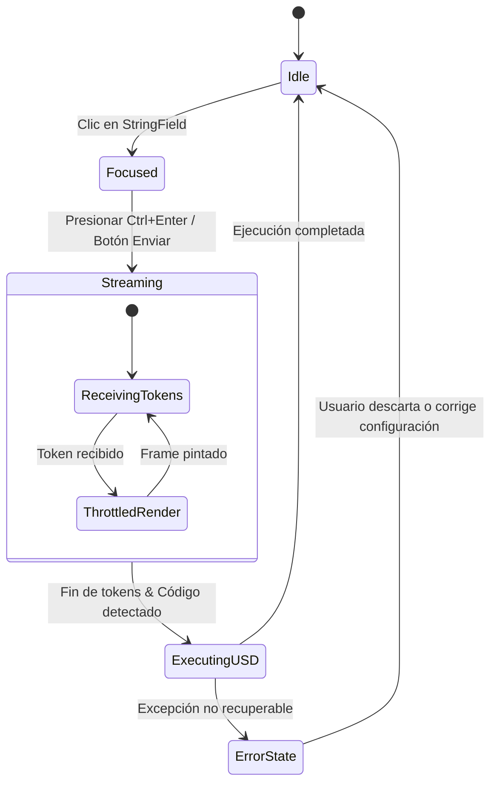

# 🎨 Especificación de Diseño UI/UX y Sistema de Tokens
# LM-Chat™ — Autonomous Spatial AI Copilot for NVIDIA Omniverse

---

## Control de Versiones del Documento

| Versión | Fecha | Autor | Rol | Estado | Resumen de Cambios |
| :--- | :--- | :--- | :--- | :--- | :--- |
| **1.0.0** | 2026-10-14 | Orlando Dorival | Lead UI/UX & Spatial Ergonomics | Aprobado | Definición de tokens de diseño NVIDIA Green/Obsidian, jerarquía de componentes en `omni.ui`, estados de interacción y accesibilidad. |

---

## 1. Filosofía de Diseño y Ergonomía Espacial

La interfaz de usuario de **LM-Chat™** está concebida como una herramienta de trabajo intensivo para artistas técnicos y desarrolladores en **NVIDIA Omniverse**. Su ergonomía debe integrarse armónicamente con el lenguaje visual de Omniverse Kit (`omni.ui`), manteniendo una huella visual limpia, alta densidad de información y cero distracciones que compitan con el Viewport 3D principal.

---

## 2. Sistema de Tokens de Diseño (Design Tokens)

### 2.1. Paleta Cromática (NVIDIA Emerald & Dark Obsidian)

| Token Semántico | Valor Hex / RGBA | Uso en la Interfaz | Ratio de Contraste |
| :--- | :--- | :--- | :--- |
| `--color-brand-nvidia` | `#76B900` / `rgba(118, 185, 0, 1)` | Identidad corporativa, bordes activos, botones primarios y acentos. | $4.8:1$ sobre fondo oscuro |
| `--color-bg-canvas` | `#121212` / `rgba(18, 18, 18, 1)` | Fondo general de la ventana desacoplable. | Base de contraste |
| `--color-bg-surface` | `#1E1E1E` / `rgba(30, 30, 30, 1)` | Fondo de tarjetas de mensajes del asistente y paneles colapsables. | Contraste con canvas |
| `--color-bg-user-bubble` | `#252B1E` / `rgba(37, 43, 30, 1)` | Fondo sutilmente oliváceo para las burbujas de mensaje del usuario. | Diferenciación clara |
| `--color-border-subtle` | `#2D2D2D` / `rgba(45, 45, 45, 1)` | Separadores de paneles, bordes de cajas de texto y scrollbars. | $3.1:1$ |
| `--color-text-primary` | `#F8FAFC` / `rgba(248, 250, 252, 1)` | Texto de lectura principal, encabezados e instrucciones. | $14.2:1$ (WCAG AAA) |
| `--color-text-secondary` | `#94A3B8` / `rgba(148, 163, 184, 1)` | Metadatos de mensajes, nombres de modelos, timestamps y hints. | $6.5:1$ (WCAG AA) |
| `--color-accent-success` | `#2ECC71` / `rgba(46, 204, 113, 1)` | Indicador de ejecución exitosa en USD y estado conectado. | $5.2:1$ |
| `--color-accent-warning` | `#F39C12` / `rgba(243, 156, 18, 1)` | Advertencias de VRAM, reintentos ReAct y modelos no óptimos. | $4.9:1$ |
| `--color-accent-error` | `#E74C3C` / `rgba(231, 76, 60, 1)` | Alertas de conexión fallida y violaciones de seguridad AST. | $5.8:1$ |

### 2.2. Tipografía y Escalas de Texto

| Nivel Tipográfico | Familia de Fuente | Tamaño (px) | Peso | Altura de Línea |
| :--- | :--- | :--- | :--- | :--- |
| **Encabezado / Título** | NVIDIA Sans / Segoe UI | 15 px | Bold (700) | 20 px |
| **Cuerpo Principal** | NVIDIA Sans / Roboto | 13 px | Regular (400) | 18 px |
| **Metadatos y Badges** | NVIDIA Sans / Segoe UI | 11 px | Medium (500) | 14 px |
| **Bloques de Código** | Consolas / Cascadia Code | 12 px | Regular (400) | 16 px |

### 2.3. Radios de Borde y Espaciado (Sistema Base de 4px)
- **Espaciados estándar:** `4px` (micro), `8px` (compacto), `12px` (estándar), `16px` (amplio).
- **Radios de Borde:** `4px` para campos de entrada y botones secundarios; `6px` para tarjetas de mensajes y bloques de código; `8px` para ventanas modales.

---

## 3. Jerarquía y Composición de Widgets en `omni.ui`

### 3.1. Barra de Encabezado Superior (Header Toolbar)
1. **Selector de Proveedor (`omni.ui.ComboBox`):** Desplegable compacto con íconos que lista los proveedores soportados (LM Studio, Ollama, vLLM, NIM, OpenAI, Anthropic, Gemini).
2. **Selector Dinámico de Modelo (`omni.ui.ComboBox`):** Muestra el modelo activo descubierto en vivo.
3. **Botón de Refresco (`omni.ui.Button`):** Ícono de sincronización circular que invoca `fetch_remote_models()` bajo demanda.
4. **Botón de Ajustes (`omni.ui.Button`):** Abre/cierra el panel colapsable de credenciales y parámetros de inferencia (temperatura, max tokens).

### 3.2. Lienzo de Conversación (`omni.ui.ScrollingFrame`)
- **Burbuja de Usuario:** Alineada al margen derecho, con fondo tenue tintado de verde oliva y tipografía primaria.
- **Burbuja de Asistente:** Alineada al margen izquierdo, con avatar distintivo de LM-Chat. El texto en streaming se actualiza de manera incremental utilizando un buffer con limitación de frecuencia (33 ms throttle) para evitar recálculos excesivos de layout.
- **Bloques de Código Python/USD:** Renderizados en un contenedor oscuro con barra superior que incluye:
  - Etiqueta del lenguaje (`python`).
  - Botón "Copiar Código" (`omni.ui.Button`).
  - Botón "Ejecutar en Stage" (`omni.ui.Button`) si la auto-ejecución está deshabilitada por el usuario.

### 3.3. Barra de Estado ReAct y Diagnósticos
Cuando se ejecuta un comando o se detecta un fallo, una barra delgada y elegante aparece entre el historial y la entrada:
- **Estado Enfriado / Éxito:** `[✓] Comando ejecutado exitosamente en /World/Props (Reversible: Ctrl+Z)`
- **Estado Reflexión Activa:** `[⟳] Reintentando generación (Paso 1/3): Corrigiendo colisión de ruta USD...`
- **Estado Fallo de Conexión:** `[!] Servidor LM Studio no detectado en el puerto 1234 [Ver Solución]`

### 3.4. Área de Entrada de Texto y Controles (Footer Area)
- **Campo de Entrada (`omni.ui.StringField` multilínea):** Altura dinámica de 40 px a 120 px según el contenido ingresado.
- **Botón de Envío (`omni.ui.Button`):** Verde esmeralda con texto o ícono de flecha.
- **Botón de Detener (`omni.ui.Button`):** Aparece durante el streaming para abortar la recepción de tokens inmediatamente.

---

## 4. Matriz de Estados de Componentes

| Componente | Estado Reposo (Idle) | Estado Hover | Estado Foco / Activo | Estado Deshabilitado |
| :--- | :--- | :--- | :--- | :--- |
| **Botón Primario** | Fondo `#76B900`, texto negro, borde nulo. | Fondo `#88D600`, cursor de puntero. | Fondo `#639C00`, escala reducida 98%. | Fondo `#2A3A15`, texto `#6B7280`. |
| **Campo de Texto** | Fondo `#1A1A1A`, borde `#2D2D2D`. | Borde `#4B5563`. | Borde `#76B900` de 1.5 px grosor. | Fondo `#111111`, texto atenuado. |
| **Selector Modelos** | Fondo `#1E1E1E`, flecha gris. | Fondo `#282828`. | Menú desplegable flotante con sombra. | Opacidad 50%. |

---

## 5. Accesibilidad y Ergonomía en Estaciones de Trabajo

1. **Atajos de Teclado Universales:**
   - `Ctrl + Enter`: Enviar instrucción al modelo.
   - `Esc`: Cancelar la transmisión de tokens en curso.
   - `Ctrl + L`: Limpiar historial de conversación de la ventana activa.
   - `Ctrl + K`: Enfocar inmediatamente la caja de texto.
2. **Escalado en Pantallas de Alta Densidad (HiDPI / 4K):**
   - Todos los tamaños de fuentes y márgenes se multiplican por el factor de escala global de DPI provisto por `omni.ui.Workspace.get_dpi_scale()`, garantizando legibilidad nítida en monitores 4K y configuraciones multi-pantalla profesionales.
3. **Soporte de Contraste y Daltonismo:**
   - La interfaz no confía exclusivamente en el color para comunicar estados críticos: los mensajes de éxito, advertencia y error siempre van acompañados de íconos textuales unívocos (`[✓]`, `[!]`, `[x]`).
