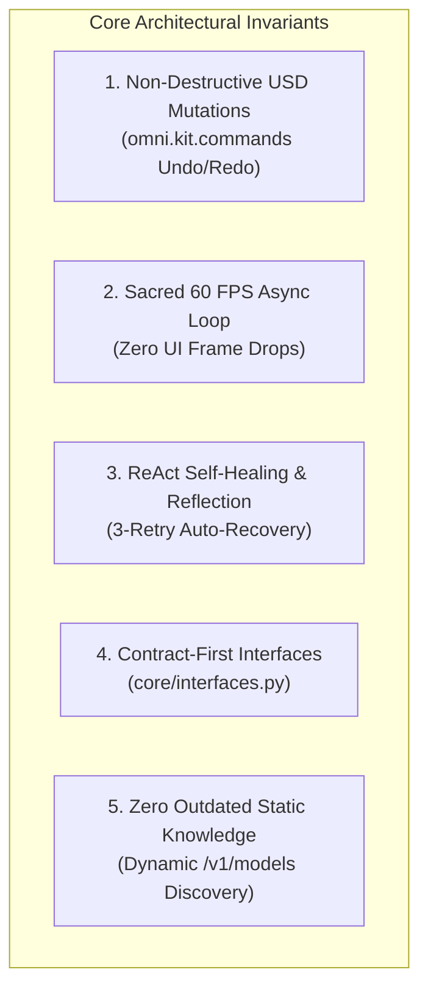

# 🌌 LM-Chat™ Technical Architecture & Design Documentation

<div align="center">

[](https://opensource.org/licenses/MIT)
[](https://github.com/Orlandho/LM-Chat-Docs)
[](http://commitizen.github.io/cz-cli/)
[](https://www.nvidia.com/en-us/omniverse/)
[](https://www.python.org/)

**Official Technical Architecture, Low-Level Design, PRD, QA Test Matrix, Operations Runbook, and Security Model for LM-Chat™ (`omni.lm_chat`).**

[Core Repository (`omni.lm_chat`)](https://github.com/orlandodorival/LM-Chat) • [Architecture Document](#-documentation-index) • [Security Policy](SECURITY.md)

</div>

---

## 📖 Overview

**LM-Chat™** is an enterprise-grade autonomous spatial AI copilot and neural assistant designed specifically for the **NVIDIA Omniverse™** ecosystem (USD Composer, Isaac Sim, Omniverse Code) built on the Kit SDK 105 / 106 / 107+.

This repository hosts the canonical, engineering-grade technical documentation, architectural specifications, product requirements, testing frameworks, and security threat models governing LM-Chat™. It serves as the single source of truth (SSOT) for software engineers, graphics pipeline architects, technical directors, AI researchers, and autonomous agent swarms.

---

## 📑 Documentation Index

| Specification Document | Scope & Focus | Primary Audience |
| :--- | :--- | :--- |
| [**01. High-Level Architecture (HLD)**](01_HIGH_LEVEL_ARCHITECTURE.md) | 4-Tier Microkernel Topology, C4 Diagrams, Sacred 60 FPS Async Event Loop, Edge Isolation, and Non-Destructive USD Mutations. | Solution Architects, Tech Leads, Core Contributors |
| [**02. Low-Level Design (LLD)**](02_LOW_LEVEL_DESIGN.md) | Component contracts (`core/interfaces.py`), Typed Schemas, Diagnostic Taxonomy, Threading Models, and ReAct Self-Healing State Machine. | Backend & Systems Engineers, SDK Implementers |
| [**03. Product Requirements Document (PRD)**](LM_CHAT_PRD.md) | User personas, 3D/Robotics use cases, MoSCoW functional requirements, and Gherkin Given-When-Then acceptance criteria. | Product Managers, Technical Directors, QA Leads |
| [**04. QA Test Plan & Acceptance Matrix**](LM_CHAT_QA_TEST_PLAN.md) | Engine-independent mock strategy, P0-P3 test matrix, 60 FPS frame time budgets, and automated Quality Gates (QG-01 to QG-08). | QA Engineers, SDETs, CI/CD Maintainers |
| [**05. Operations & SRE Runbook**](LM_CHAT_OPERATIONS_RUNBOOK.md) | Environment configuration, Extension packaging, dynamic diagnostics, and Incident Response Playbooks (INC-01 to INC-04). | DevOps / SRE, Extension Administrators |
| [**06. UI/UX Design Handoff Spec**](LM_CHAT_UI_UX_SPEC.md) | NVIDIA Obsidian & Emerald Green design tokens, `omni.ui` layout hierarchy, component states, and accessibility standards. | Frontend / UI Engineers, 3D Ergonomics Designers |
| [**07. Security Policy & AI Threat Model**](SECURITY.md) | Spatial AI STRIDE threat modeling, AST code sandboxing, MCP capability boundaries, secret vaults, and RFC 9116 disclosure. | Security Engineers, DevSecOps, Enterprise Auditors |

---

## 🏛️ Architectural Invariants at a Glance

All specifications and codebase implementations adhere strictly to the **LM-Chat Universal Charter** (`AGENTS.md`):



1. **Non-Destructive USD Mutations:** All scene modifications are executed via `omni.kit.commands` or reversible undo blocks, preserving native `Ctrl+Z` / `Ctrl+Y`.
2. **Sacred 60 FPS Async Loop:** Token streaming, heavy computation, and I/O never block the Kit main rendering thread.
3. **ReAct Self-Healing & Reflection:** Code generation errors are intercepted, converted to reflection prompts, and autonomously repaired.
4. **Contract-First Modular Decomposition:** Core abstractions are strictly decoupled via interfaces (`IInferenceRouter`, `ISettingsManager`, `IMCPClientRegistry`, `IUSDController`, `IAgentManager`).
5. **Zero Outdated Static Knowledge:** Runtime dynamic model discovery (`/v1/models`, `/api/tags`) ensures live model catalogs across local and cloud providers.

---

## 🔄 Version Synchronization & Commitizen

This documentation repository is version-synchronized with the main `LM-Chat` extension codebase using **Semantic Versioning (SemVer 2.0.0)** and **Commitizen**:

```bash
# Verify current version sanity
python sync_version.py --check

# Check commit messages format
cz check --message "feat(architecture): add spatial AST sandboxing specification"

# Bump version synchronously across repository files
cz bump --increment [patch|minor|major]
```

### Synchronizing with Main Extension

To synchronize versions with the `omni.lm_chat` repository:
```bash
python sync_version.py --target-repo "C:/Users/Orlando/Desktop/LM-Chat" --sync
```

---

## 📜 License

This documentation suite is licensed under the [MIT License](LICENSE).
Copyright © 2026 Orlando Dorival.
