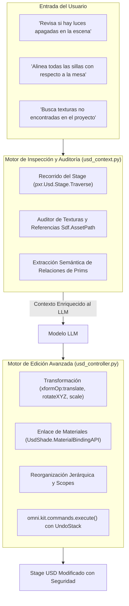

# 🔍 Plan Técnico: Ampliación del Alcance de Edición e Inspección del Proyecto
# LM-Chat™ — Feature Specification & Implementation Plan

---

## 1. Identificación y Estado de la Tarea

| Metadato | Detalle |
| :--- | :--- |
| **Origen / Calendario:** | Google Tasks — *"LACFNO - Ampliar alcance de edicion de la IA en el proyecto. Implementar codigo para que la IA sea capaz de no solo crear objetos. sino tambien revisar el proyecto ..."* |
| **Proyecto Histórico:** | LACFNO / LLM-Chat / LM-Chat |
| **ID del Plan:** | `PLAN-USD-SCOPE-02` |
| **Estado:** | 🟡 Parcialmente implementado (Serializador de Stage presente) — Pendiente Mutación Completa y Auditoría de Proyecto |
| **Prioridad:** | Alta (P1) |

---

## 2. Resumen Ejecutivo y Necesidad Técnica

Originalmente, los asistentes para motores 3D se limitaban a la **creación básica de objetos** (e.g. `CreatePrim("Sphere")` o `CreatePrim("Light")`). Sin embargo, en un pipeline profesional de **NVIDIA Omniverse** (USD Composer / Isaac Sim), el trabajo real de los directores técnicos consiste en:
1. **Inspeccionar y diagnosticar la escena completa:** detectar mallas con texturas perdidas, capas no guardadas, prims sin colisión física o escalas no normalizadas.
2. **Editar y transformar prims preexistentes:** modificar rotaciones, traslaciones, asociar shaders MDL existentes, reorganizar la jerarquía del Stage y agrupar elementos bajo nuevos scopes.
3. **Eliminar y renombrar de forma no-destructiva:** supresión controlada de geometrías redundantes con historial de deshacer (`Ctrl+Z`).

---

## 3. Arquitectura del Sistema de Inspección y Edición



---

## 4. Módulos y Métodos a Implementar

### 4.1. Auditoría del Proyecto (`logic/usd_inspector.py`)
Nuevo componente que implementa las siguientes capacidades de lectura y diagnóstico:
- `audit_missing_assets() -> List[Dict[str, Any]]`: Escanea todos los atributos de tipo `Sdf.AssetPath` en el Stage y valida la existencia de los archivos en disco.
- `find_prims_by_query(query_criteria: Dict[str, Any]) -> List[str]`: Permite búsquedas complejas por tipo (`UsdLux.Light`, `UsdGeom.Mesh`), visibilidad (`visibility == 'invisible'`) o atributos personalizados.
- `get_layer_stack_status() -> Dict[str, Any]`: Informa sobre la capa raíz, capas de sesión y subcapas anónimas modificadas no guardadas.

### 4.2. Ampliación de Mutaciones No-Destructivas (`logic/usd_controller.py`)
Garantizar comandos prefabricados que la IA pueda invocar o generar mediante Python seguro:
- **Transformación de Objetos Existentes:**
  ```python
  omni.kit.commands.execute(
      "TransformPrimCommand",
      path=prim_path,
      new_transform_matrix=target_matrix
  )
  ```
- **Asignación de Shaders MDL:**
  ```python
  omni.kit.commands.execute(
      "BindMaterialCommand",
      prim_path=mesh_path,
      material_path=mat_path
  )
  ```
- **Reorganización y Agrupación Jerárquica:**
  ```python
  omni.kit.commands.execute(
      "GroupPrimsCommand",
      prim_paths=selected_paths,
      parent_path="/World/Props_Group"
  )
  ```

---

## 5. Criterios de Aceptación y Pruebas

| ID de Caso | Descripción de la Prueba | Criterio de Pase |
| :--- | :--- | :--- |
| `TC-EDT-001` | Modificación de intensidad de todas las luces del Stage | Todas las luces cambian de atributo sin alterar su posición ni crear nuevas luces. |
| `TC-EDT-002` | Auditoría de texturas rotas con reporte en chat | La IA lista las rutas exactas de los archivos `.png`/`.dds` no localizados en disco. |
| `TC-EDT-003` | Reorganización de prims sueltos bajo un Scope `/World/Furniture` | Los prims se mueven en la jerarquía manteniendo sus coordenadas globales intactas. |
| `TC-EDT-004` | Deshacer (`Ctrl+Z`) de una edición masiva | Presionar `Ctrl+Z` restaura las propiedades originales de los 10 objetos modificados en un solo paso. |
