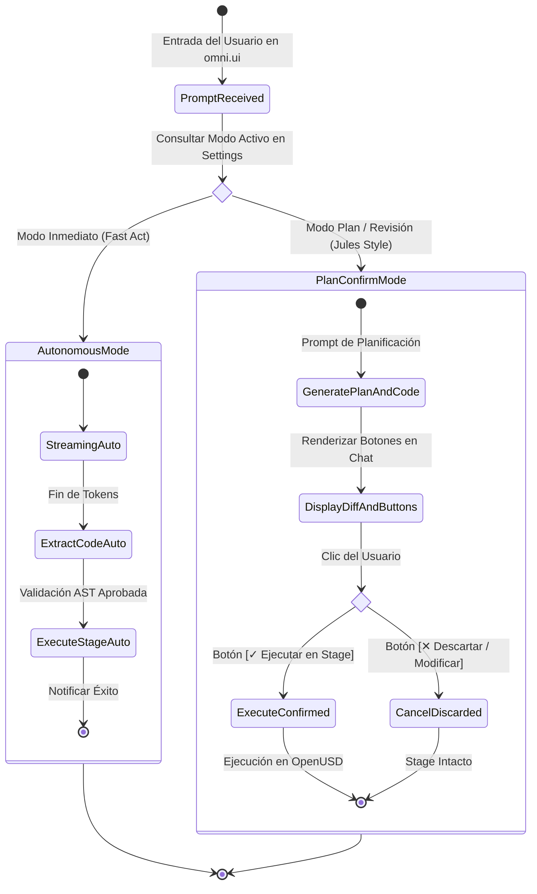

# ⚡ Plan Técnico: Modos de Ejecución Inmediato vs. Plan/Confirmación
# LM-Chat™ — Feature Specification & Implementation Plan

---

## 1. Identificación y Estado de la Tarea

| Metadato | Detalle |
| :--- | :--- |
| **Origen / Calendario:** | Google Tasks — *"LACFNO - Implementar modos d... Implementar 2 modos parecidos a gemini CLI o Jules: 1.- la IA hace lo que se le pide de inmediato. 2.- la IA [planea/pregunta antes de ejecutar]"* |
| **Proyecto Histórico:** | LACFNO / LLM-Chat / LM-Chat |
| **ID del Plan:** | `PLAN-EXEC-MODES-03` |
| **Estado:** | 🔴 Pendiente de Implementación (Flujo actual es 100% automático sin confirmación interactiva) |
| **Prioridad:** | Alta (P1) |

---

## 2. Resumen Ejecutivo y Necesidad Técnica

En herramientas de desarrollo asistido por IA modernas como **Gemini CLI** o **Jules (Google / GitHub)**, el usuario dispone de dos filosofías de interacción fundamentales:
1. **Modo Inmediato (Direct / Autonomous Act):** Ideal para prototipado rápido y tareas sencillas. La IA recibe la orden, genera el script y lo aplica instantáneamente en el entorno.
2. **Modo Plan / Revisión (Plan-First / Interactive Review):** Indispensable para escenas de producción complejas, grandes pipelines o modificaciones destructivas/masivas. La IA desglosa primero un **plan de acción paso a paso**, muestra una previsualización del código Python/USD y solicita confirmación explícita antes de ejecutar cualquier cambio en el Stage.

---

## 3. Arquitectura de los Modos de Ejecución

---

## 4. Diseño de Componentes e Interfaz en `omni.ui`

### 4.1. Selector de Modo en la Barra de Encabezado (`ui/chat_window.py`)
En el encabezado principal de la ventana de LM-Chat, junto al selector de proveedor y modelo, se añade un control de alternancia (Segmented Button o ComboBox):
- **⚡ Inmediato:** Icono de rayo verde. Ejecución sin esperas.
- **📝 Plan & Confirm:** Icono de cuaderno/revisión. La IA siempre presenta un plan y espera confirmación.

Persistencia en `carb.settings`: `/exts/omni.lm_chat/execution_mode` (`"immediate"` | `"plan_and_confirm"`).

### 4.2. Tarjeta Interactiva de Previsualización y Confirmación
En el Modo Plan & Confirm, tras completar el streaming de la propuesta:
1. El código no se envía a `usd_controller.execute_code()` inmediatamente.
2. La burbuja del asistente agrega dinámicamente un contenedor interactivo con dos botones:
   - **`[✓ Ejecutar en Escena]` (`omni.ui.Button`):** Fondo verde `#76B900`, ejecuta el código en el Stage a través del historial de deshacer.
   - **`[✕ Cancelar]` (`omni.ui.Button`):** Fondo gris `#444444`, descarta la propuesta dejando la escena intacta y permite al usuario ajustar la instrucción con un prompt subsiguiente.

### 4.3. Adaptación del System Prompt según el Modo Activo
- **En Modo Plan & Confirm:** El system prompt inyecta la directiva:
  > *"Presenta primero una breve lista numerada con los pasos de tu plan. Luego muestra el bloque de código OpenUSD propuesto sin asumir que ya ha sido ejecutado. Espera la confirmación del usuario."*
- **En Modo Inmediato:** El system prompt conserva la directiva:
  > *"Genera directamente el bloque de código OpenUSD ejecutable para que el sistema lo aplique de forma autónoma en la escena."*

---

## 5. Criterios de Aceptación y Pruebas

| ID de Caso | Descripción de la Prueba | Criterio de Pase |
| :--- | :--- | :--- |
| `TC-MOD-001` | Solicitud en Modo Inmediato | El prim se crea en el Viewport tan pronto finaliza el streaming, sin requerir clics adicionales. |
| `TC-MOD-002` | Solicitud en Modo Plan & Confirm | El prim **no** se crea tras el streaming; se renderizan los botones `[Ejecutar en Escena]` y `[Cancelar]`. |
| `TC-MOD-003` | Clic en `[Ejecutar en Escena]` | El código se ejecuta de inmediato en el Stage y se registra en `Ctrl+Z`. Los botones de confirmación se deshabilitan para evitar doble ejecución. |
| `TC-MOD-004` | Clic en `[Cancelar]` | La escena permanece 100% inalterada y el estado del chat vuelve a reposo (Idle). |
